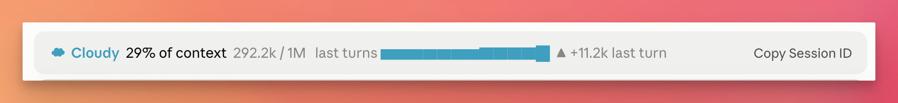

# Copy Session ID

A [Claude Code mod](https://code.claude.com/docs/en/plugins/mods/overview) that adds a **Copy Session ID** button to the band above the prompt. One click copies the current session's ID to the clipboard, the same ID that `claude --resume <id>` takes, and shows it in a toast.



## Install

In a Claude Code session:

```
/plugin install copy-session-id --marketplace aquarius-wing/copy-session-id
```

Or from your shell:

```bash
claude plugin marketplace add aquarius-wing/copy-session-id
claude plugin install copy-session-id@copy-session-id --scope user
```

If a session is already open, run `/reload-plugins` in it.

**Requirements:** Claude Code 2.1.287 or later, where mods load by default. The button shows in the terminal and in the Code tab of the Desktop app. Tested in the Desktop app's Code tab with Claude Code 2.1.295.

## How it works

The mod is one hook, on `ui.render` for the `AbovePrompt` site:

- It calls `next(e)` first and keeps what the mods after it draw, then adds the button beside that.
- While a survey holds the band (`e.props.hasSurvey`), it passes the band on untouched.
- Pressing the button reads `$.session.id()`, writes it to the clipboard of the app you pressed it in with `$.ui.copy`, and shows it with `$.ui.toast`. If the clipboard write fails, the toast still shows the ID, with the reason.

It reads no files, starts no processes and makes no network requests. `claude plugin validate` lists everything it calls:

```
hooks: ui.render{component=AbovePrompt}
calls: $.session.id, $.ui.copy, $.ui.resolve, $.ui.toast
```

## Sharing the band with other mods

The band above the prompt is one site that every mod drawing there shares. Mods run as a chain, and the first one decides what the band shows. This mod keeps whatever the mods after it draw, so it never hides them. A mod that runs before it and returns its own line without calling `next(e)` hides this button, along with every other band mod after it.

If the button doesn't show while another band mod is installed:

- **Ask that mod to compose with `next(e)`.** The [mods docs](https://code.claude.com/docs/en/plugins/mods/interface#pick-where-to-draw) describe this: put the result of `await next(e)` in your own tree to keep what the others draw. For example, the Token Weather sample mod hides other band mods; [anthropics/claude-code-playground#7](https://github.com/anthropics/claude-code-playground/pull/7) changes that.
- **Run this mod first.** On a machine with no managed settings, and when you aren't signed in with a Team or Enterprise plan, you can list plugin ids in `prependPlugins` in `~/.claude/settings.json` to run them before the other mods you install (see the [mods admin docs](https://code.claude.com/docs/en/plugins/mods/admin#install-your-organizations-mods)):

  ```json
  {
    "prependPlugins": ["copy-session-id@copy-session-id"]
  }
  ```

  Then run `/reload-plugins` in each open session. To check it took, start `claude --debug-file debug.log` and look for `hooks module copy-session-id@copy-session-id loaded (..., tier prepend)`. Tested with Claude Code 2.1.295 on a personal Max plan.

## Development

```bash
claude plugin validate .
claude plugin test .
```

The tests in `hooks/register.test.ts` mount the band on the terminal and Desktop surfaces with a stand-in for another band mod, press the button, and check what reaches the clipboard and the toast.

## License

[MIT](LICENSE)
